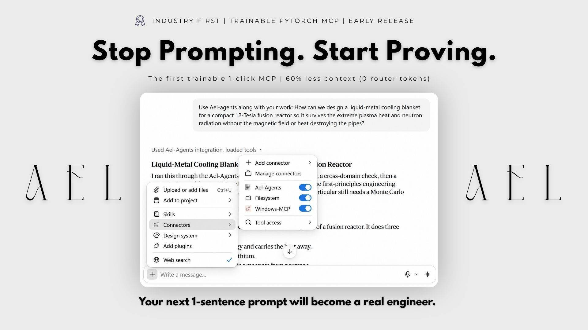
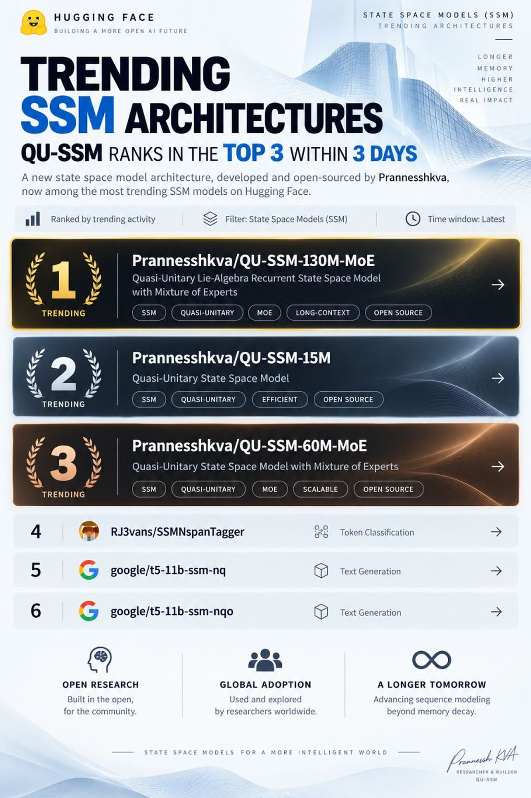

<p align="center">
  
</p>

<p align="center">
  <a href="https://github.com/prannesshkva"></a>
  <a href="https://github.com/prannesshkva/Ael-Agents/releases/tag/v1.2.0"></a>
  <a href="https://doi.org/10.17605/OSF.IO/7R46Z"></a>
  <a href="https://huggingface.co/prannesshkva"></a>
  <a href="https://smith.langchain.com/public/71010a71-b6cf-4e07-b6db-2d3553ad4a3a/r"></a>
  <a href="https://leetcode.com/u/prannesshkva/"></a>
</p>

---

### Core Engineering Philosophy

I am an **AI Systems Architect and deployment-focused builder** who bridges rigorous mathematical theory into fast, compilable, zero-token production systems. Rather than relying on heuristic prompt chains, I build production systems grounded in **continuous Lie-group state spaces, Determinantal Point Processes, and exact PyTorch autograd Jacobians** that self-falsify in code before emitting answers.

---

### Core Engineering Stack

#### Agentic Orchestration, MCP & Production LLM Engineering
<p align="left">
  
  
  
  
  
  
  
</p>

#### Foundational Modeling, Mathematics & Accelerators
<p align="left">
  
  
  
  
  
  
  
</p>

#### Systems Engineering, Cloud & Infrastructure
<p align="left">
  
  
  
  
  
  
  
</p>

---

### Systems Architecture & Research Lineage

The research lineage began with the monolithic unification of graph representations and recurrent state spaces (**SAGUS**), which isolated the mathematical challenge of non-dissipative recurrent memory dynamics (resolved by **QU-SSM** via continuous Lie-group $\text{SO}(N)$ isometries). These foundations converged into **Ael-Agents**, replacing heuristic multi-agent prompt wrappers with a differentiable cortical co-processor.

```
                      ┌────────────────────────────────────────┐
                      │                 SAGUS                  │
                      │  State-Aware Graph Unified System      │
                      │  (Monolithic Continuous Architecture)  │
                      └──────────────────┬─────────────────────┘
                                         │
                                         ▼
                      ┌────────────────────────────────────────┐
                      │                QU-SSM                  │
                      │  Quasi-Unitary State-Space Models      │
                      │  Continuous Lie-Group SO(N) Isometries │
                      │  Non-Dissipative Recurrence (CUDA C++) │
                      └──────────────────┬─────────────────────┘
                                         │
                                         ▼
   ┌────────────────────────────────────────────────────────────────────────┐
   │                     Ael-Agents (v1.2.0 Production)                     │
   │      Trainable Cortical Co-Processor & Programmatic Verification      │
   ├────────────────────────────────────────────────────────────────────────┤
   │  • Wake:  768-D DPP Orthogonal Specialist Selection (log det L_S)       │
   │  • Focus: 0-Token PyTorch Autograd Jacobian Gate (k=2 Working Memory)   │
   │  • Prove: Sandboxed Python / SciPy / RK45 Programmatic Verifier        │
   │  • Dream: Offline 15-Epoch AdamW Weight Training (F_dream <= F_wake)   │
   └────────────────────────────────────────────────────────────────────────┘
```

---

### Flagship Systems & Implementations

#### 1. [Ael-Agents](https://github.com/prannesshkva/Ael-Agents) — Trainable Cortical Co-Processor & Programmatic Tool Calling Engine (`v1.2.0`)

A 100% domain-agnostic, PyTorch-differentiable multi-agent co-processor and Model Context Protocol (MCP) server. Enables any frontier LLM to act as a self-falsifying Principal Engineer from a single 1-sentence prompt.

<p align="center">
  
</p>

* **0-Token PyTorch Autograd Jacobian Gate:** Replaces expensive LLM-as-a-Judge supervisor agents with exact gradient sensitivities ($J_i = \|\partial y / \partial w_i\|_2$) across trainable specialist weights, pruning **60%+ of context bloat** at **0 LLM routing tokens** ($<15\text{ ms}$ on CPU).
* **768-D DPP Orthogonal Specialist Decomposition:** Partitions any single-sentence query into $N$ mutually orthogonal specialist domains (default $N=4$, dynamically configurable $2 \dots 8$) via Determinantal Point Process log-volume maximization ($\log\det L_S$) in `BAAI/bge-base-en-v1.5` space.
* **Anthropic-Style Programmatic Tool Calling (`Ael-Agents_programmatic_verify`):** Forces the model to write and execute a self-contained Python/SciPy/PyTorch verification script (`record_candidate`) to simulate and reject failing architectures before generating the final answer.
* **Offline Dream-RSI Consolidation:** Runs 15 epochs of AdamW gradient descent minimizing `UnifiedCortexLoss` (Task Alignment + Participation Ratio Diversity + Gate Entropy) with a strict thermodynamic acceptance gate ($F_{\text{dream}} \le F_{\text{wake}}$), adapting neural weights to the user's domain in real time.
* **1-Click MCP Plug-in:** Works out-of-the-box in **Claude Desktop, Cursor, Windsurf, and Cline** (`claude mcp add Ael-Agents -- python mcp_server.py`).

---

#### 2. [QU-SSM](https://github.com/prannesshkva/QU-SSM) — Non-Dissipative Lie-Algebra Recurrent State-Space Models

A continuous-time state-space architecture resolving the fundamental compromise between numerical stability and long-range memory retention in recurrent models.

<p align="center">
  
</p>

* **Hugging Face Trending Recognition:** Ranks **#1, #2, and #3** simultaneously within 3 days of release across open-source SSM architectures (`QU-SSM-130M-MoE`, `QU-SSM-15M`, `QU-SSM-60M-MoE`).
* **Lie-Group Unitary Recurrence:** Enforces continuous state transitions along $\text{SO}(2)$ and $\text{SO}(16)$ orthogonal Lie groups, preventing contractive eigenvalue decay and catastrophic forgetting in linear SSMs.
* **Gradient Preservation:** Eliminates exploding and vanishing gradient dynamics across extended horizons without artificial normalization resets.
* **Custom CUDA Kernel:** Integrated custom CUDA C++ kernel (`qu_ssm_cuda.cu`) providing hardware-native execution and numerical parity with theoretical derivations.

---

#### 3. SAGUS (State-Aware Graph Unified System) — Monolithic Origin

The foundational unified architecture that integrated graph topological structures directly into continuous state spaces, establishing the mathematical basis for orthogonal manifold state propagation.

---

### Algorithmic Rigor & Systems Engineering Foundations

<p align="center">
  <a href="https://leetcode.com/u/prannesshkva/" target="_blank">
    
  </a>
</p>

- **700+ Algorithmic Challenges Solved** spanning graph theory, continuous dynamic programming, computational geometry, numerical optimization, and non-blocking concurrent data structures.
- Direct mechanical sympathy across **Python, PyTorch autograd, CUDA C++, C++, and Linux systems internals**.
- **Production Translation**: Direct translation of algorithmic complexity bounds into low-latency, compilable distributed pipelines.

---

### Empirical Proof Points & Deterministic Benchmarks

| System | Benchmark & Task | Baseline Architecture | First-Principles Result | Verification Standard |
| :--- | :--- | :--- | :--- | :--- |
| **Ael-Agents** | **12-Tesla Fusion MHD Blanket**<br>*(1-Sentence Prompt)* | Standalone Extended-Thinking LLM (`15/40`, `21/50`) | **`34 / 40` (`42 / 50` w/ breadth, `2.3×` lift)**<br>Caught 30× circular hoop stress formula error (`182 MPa` vs `6,050 MPa` flat-plate bending); tested 5 duct models in SciPy | Blinded Peer Review + SciPy Programmatic Sandbox |
| **Ael-Agents** | **100,000 Spin Qubits @ 100 mK**<br>*(1-Sentence Prompt)* | Standalone Frontier LLM (`9/40`) | **`30 / 40` (`3.3×` lift)**<br>Caught internal 37× thermal-photon error ($\bar{n} = 0.1 \to 3.7$); verified staged $10\text{ dB @ 1 K} + 10\text{ dB @ 100 mK}$ ($0.22\text{ K}$, $120\text{ }\mu\text{W}$) | Python Bose–Einstein Integration + Blinded Audit |
| **Ael-Agents** | **De Novo KRAS-G12D Inhibitor** | Single LLM (`openai/gpt-oss-20b`) | **QED 0.716**, 0 Lipinski violations, 100% steady-state trough target occupancy | RDKit Compiler + SciPy RK45 PK/PD ODEs |
| **Ael-Agents** | **MedMCQA Pharmacology ($N=9$)** | Single LLM Baseline: 77.78% (7/9) | **100.00% (9/9, +22.22% gain)** | USMLE / Medical Board Exam Standard |
| **Ael-Agents** | **Token Efficiency & Latency** | Standard 4-Agent Swarms (~35,000 tokens) | **~2,200 tokens (-93.7% reduction, 0 router tokens)** | [Public LangSmith Telemetry Trace](https://smith.langchain.com/public/71010a71-b6cf-4e07-b6db-2d3553ad4a3a/r) |
| **Ael-Agents** | **Human Semantic Alignment** | SimLex-999 / STS-Benchmark | **$\rho = +0.5711$ / $\rho = +0.8642$** | Spearman Rank Correlation ($p < 10^{-80}$) |
| **QU-SSM** | **Recurrence Stability** | Linear SSMs (Eigenvalue Decay) | **Strict Unitary Preservation ($\text{SO}(N)$)** | Custom CUDA Kernel Hardware Parity |

---

### Repositories & Artifacts

- **Ael-Agents (v1.2.0 Production):** [github.com/prannesshkva/Ael-Agents](https://github.com/prannesshkva/Ael-Agents)
- **Ael-Agents 2-Domain Benchmark Case Study:** [gist.github.com/prannesshkva/637c5b9fcad19c99cf652b9ec6ef8e91](https://gist.github.com/prannesshkva/637c5b9fcad19c99cf652b9ec6ef8e91)
- **Model Checkpoints & Weights:** [huggingface.co/prannesshkva](https://huggingface.co/prannesshkva)
- **LeetCode Algorithmic Profile:** [leetcode.com/u/prannesshkva](https://leetcode.com/u/prannesshkva/)
- **Public Execution Trace:** [LangSmith Telemetry Trace](https://smith.langchain.com/public/71010a71-b6cf-4e07-b6db-2d3553ad4a3a/r)
- **License:** Creative Commons Attribution-NonCommercial-NoDerivatives 4.0 International (CC BY-NC-ND 4.0)
